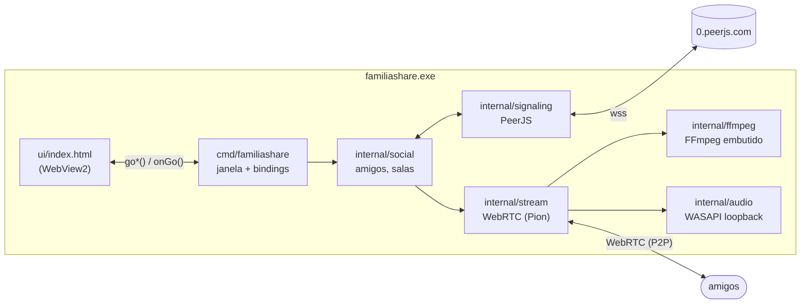
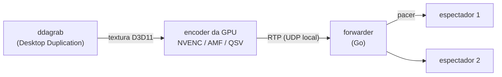

# Arquitetura

O familiashare é um único `.exe` em Go. A interface é uma página HTML/JS rodando no
WebView2 (o Edge embutido no Windows); todo o resto — captura, codificação, transmissão,
sinalização e integração com o Windows — fica em Go.

## Pacotes

| Pacote | Responsabilidade |
|---|---|
| [`cmd/familiashare`](../cmd/familiashare) | `main`: pasta de dados, log, janela WebView2, e as funções que a página chama (`bindings.go`). Modos de desenvolvimento (`devmodes.go`, `bench.go`). |
| [`ui`](../ui) | A interface inteira (`index.html`), embutida no `.exe`. Também é quem **assiste** (o WebRTC do navegador recebe e decodifica o vídeo). |
| [`internal/social`](../internal/social) | Amigos, presença, salas e quem pode assistir quem. Não sabe nada de rede: recebe mensagens e envia por uma interface (testável com uma sinalização falsa). |
| [`internal/signaling`](../internal/signaling) | Conexão com o servidor PeerJS e o formato das mensagens ([PROTOCOL.md](PROTOCOL.md)). |
| [`internal/stream`](../internal/stream) | O lado de quem **transmite**: escolhe o encoder, roda o FFmpeg, e envia o vídeo/áudio por WebRTC (Pion) a cada espectador. |
| [`internal/audio`](../internal/audio) | Captura o áudio do PC com WASAPI *process loopback*, excluindo apps escolhidos. |
| [`internal/ffmpeg`](../internal/ffmpeg) | O FFmpeg embutido (comprimido com zstd), extraído na primeira execução. |
| [`internal/capture`](../internal/capture) | Lista monitores e qual GPU cuida de cada um (DXGI). |
| [`internal/config`](../internal/config) | `config.json` (código, nome, amigos, ajustes) e migração de versões antigas. |
| [`internal/update`](../internal/update) | Procura e aplica atualizações (GitHub Releases). |
| [`internal/changelog`](../internal/changelog) | Lê o `CHANGELOG.md` embutido para a tela de Novidades. |
| [`internal/winapi`](../internal/winapi) | Chamadas diretas ao Windows: COM, janela (incluindo a barra de título própria, em `frame.go`), DPI, prioridade de processo/GPU, ícone perto do relógio e instância única. |
| [`internal/applog`](../internal/applog) | Log em disco para diagnóstico: tamanho limitado e filtro de dados pessoais. |

## Caminho do vídeo

1. **Captura e codificação no FFmpeg.** O filtro `ddagrab` captura o monitor direto na
   GPU e entrega a textura ao encoder da mesma GPU sem passar pela memória do PC
   (*zero-copy*). Quando não dá (escala para resolução menor, encoder de software, GPU
   diferente), o caminho é `hwdownload → scale → nv12` na CPU.
2. **Um encoder para todos.** O FFmpeg empacota em RTP e manda para uma porta UDP local. O
   `forwarder` lê esses pacotes uma vez e repassa a cada espectador, reescrevendo número
   de sequência e timestamp (cada conexão começa do zero).
3. **Pacer.** Quadros-chave chegam em rajadas grandes; o *pacer* (token bucket a 3× o
   bitrate) espalha os pacotes para não estourar buffers de roteador.
4. **Quem entra no meio.** Um quadro-chave é forçado a cada 2 s, para quem começa a
   assistir ver imagem rapidamente. Perdas são recuperadas por NACK (o Pion guarda os
   últimos 8192 pacotes).

O áudio segue o mesmo caminho: WASAPI → PCM → FFmpeg (Opus 256 kbps estéreo) → RTP.

### Escolha do encoder

`candidatePipelines` ([pipeline.go](../internal/stream/pipeline.go)) monta a lista em
ordem de preferência — encoder da GPU do monitor com zero-copy primeiro, depois as outras
GPUs, depois Media Foundation e por fim x264/CPU — e o app usa o primeiro que conseguir
produzir quadros. O bitrate "auto" é `largura × altura × fps × 0,2` (×0,75 em AV1), entre
8 e 60 Mbps.

## Áudio sem um app (ex.: Discord)

O Windows permite capturar o áudio **de uma árvore de processos** (incluindo ou
excluindo). Como só dá para excluir uma árvore por captura, quando há apps excluídos o app
faz o contrário: abre uma captura *incluindo* cada app que tem sessão de áudio e não foi
excluído, e mistura tudo. Sem exclusões, é uma captura única excluindo o próprio
familiashare (para quem assiste ao mesmo tempo não retransmitir o som). A decisão está em
`planTargets` ([engine.go](../internal/audio/engine.go)) e é refeita periodicamente,
conforme apps abrem e fecham.

## Interface ↔ Go

A página chama funções Go expostas pelo WebView2 (`goStartShare(...)`, `goJoin(...)`, ...;
lista em [bindings.go](../cmd/familiashare/bindings.go)), que retornam Promises. O Go
avisa a página chamando `window.onGo(evento)` — mudanças de estado, ofertas WebRTC
recebidas, avisos. A página é servida por um servidor HTTP local (em vez de `file://`) para
o WebRTC funcionar.

## Atualização

O build de release grava a versão (`0.x.y`) no programa. Ao abrir, a cada 3 h e quando a janela volta ao primeiro plano, o app
consulta a API do GitHub pelo último release (pré-lançamentos, como o do FFmpeg, ficam de
fora) e, se for mais novo, avisa. Ao atualizar, baixa o `familiashare.exe` do release,
confere tamanho e SHA-256 com o que o GitHub informa, renomeia o `.exe` atual para `.old`
(o Windows deixa renomear um programa em uso), coloca o novo no lugar e reinicia.

Até a 0.1.2 a atualização vinha de um link do Google Drive: o app lia uma etiqueta
`FAMILIASHARE-BUILD:aaaammdd-hhmmss` no fim do arquivo publicado. O build ainda anexa essa
etiqueta para que essas versões antigas atualizem para a 0.2.0 pelo Drive; depois que
todos estiverem na 0.2+, ela pode sair do `build.ps1`.

As novidades mostradas em Configurações vêm do próprio `CHANGELOG.md`, embutido no
`.exe` e lido por [`internal/changelog`](../internal/changelog/changelog.go).

## Lições aprendidas

Coisas que custaram caro para descobrir; leia antes de mexer nessas partes.

- **AMF e quadros-chave.** O AMF ignora `-force_key_frames` sem `-forced_idr 1` e gera um
  único IDR — quem entra depois fica com tela preta. NVENC usa `-forced-idr` (com hífen).
  Há teste de regressão.
- **Media Foundation** com `-hw_encoding 1` falha em várias máquinas; usamos sem.
- **`scale_d3d11`** está quebrado nesta versão do FFmpeg; a escala é feita na CPU.
- **Prioridade da GPU.** Com um jogo ocupando a GPU, o encoder atrasa. O FFmpeg recebe
  prioridade alta de agendamento na GPU (`D3DKMTSetProcessSchedulingPriorityClass`).
- **Callbacks COM e o coletor de lixo.** Objetos Go passados como callback para o Windows
  (ativação do áudio) precisam ficar referenciados (`keepHandlers`), senão o GC os libera
  e o app fecha sozinho.
- **Processos filhos.** O FFmpeg roda dentro de um *Job object* que o Windows encerra junto
  com o app, mesmo se ele fechar de repente.
- **PeerJS** derruba quem foge do formato dele ([PROTOCOL.md](PROTOCOL.md)).
- **Áudio no WebView2** começa mudo sem `--autoplay-policy=no-user-gesture-required`, e
  ao reanexar uma track o elemento `<video>` volta a ficar mudo.
