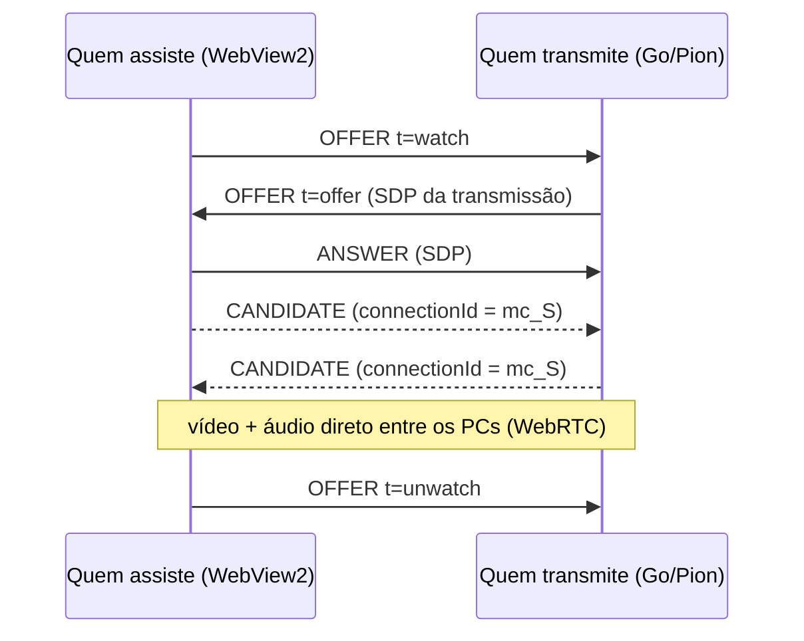

# Protocolo entre apps

Os apps não têm servidor próprio. Para se encontrar e combinar as conexões eles usam o
servidor público de sinalização do [PeerJS](https://peerjs.com) (`wss://0.peerjs.com/peerjs`),
que só repassa mensagens pequenas entre quem está conectado. O vídeo e o áudio vão
direto entre os PCs, por WebRTC.

Código: [`internal/signaling`](../internal/signaling/signaling.go) (envelope e conexão) e
[`internal/social`](../internal/social/social.go) (o que cada mensagem significa).

> **Compatibilidade:** nem todo mundo atualiza ao mesmo tempo. Qualquer mudança aqui
> precisa continuar funcionando com a versão anterior — campos novos são opcionais e tipos
> desconhecidos são ignorados.

## Identidade

Cada instalação tem um **código de amigo** de 8 caracteres (alfabeto sem letras/números
ambíguos: `abcdefghjkmnpqrstuvwxyz23456789`), gerado na primeira execução e salvo no
`config.json`. No servidor PeerJS o id é `telau-<código>` — o prefixo vem do nome antigo
do projeto e **não pode mudar** sem quebrar a comunicação com versões anteriores.

Se o servidor responder `ID-TAKEN` (o mesmo código já está conectado, ex.: o app aberto
duas vezes), o app avisa e tenta de novo.

### Assinatura (depois da 0.6.1)

O servidor entrega o ID `telau-<código>` a **quem conectar primeiro**, sem pedir prova de
nada. Com a pessoa offline, qualquer um que saiba o código dela pode se conectar com ele.
(Com ela online, o servidor responde `ID-TAKEN`, e o `src` das mensagens é sempre
preenchido pelo servidor, não por quem envia.) Para quem recebe saber que a mensagem é
mesmo daquela pessoa, cada instalação tem um par de chaves **Ed25519**, gerado na primeira
execução. A chave privada fica no `config.json` (`key`) e nunca vai para a página nem
para o log.

Toda mensagem enviada leva, no payload:

| Campo | Significado |
|---|---|
| `k` | chave pública de quem envia (base64, 32 bytes) |
| `s` | assinatura Ed25519 (base64) dos dados abaixo |

O servidor (Node.js) relê e reescreve o JSON, mudando a ordem dos campos e os escapes. Por
isso a assinatura não cobre os bytes recebidos. Ela cobre uma forma canônica, refeita por
quem recebe (`signedData` em [signaling.go](../internal/signaling/signaling.go)):

```
"familiashare-assinatura-v1\n" + JSON{Kind, Src, Dst, Conn, T, D, Cand, SDP}
```

Os campos são o tipo (`OFFER`…), os códigos de quem envia e de quem recebe (sem prefixo),
o `connectionId`, o `t`, o `d` e o `candidate` relidos e reescritos pelo Go (chaves em
ordem), e o `sdp`. Como o destino está incluído, quem recebe uma mensagem assinada não
consegue reaproveitá-la com outra pessoa.

Quem recebe:

- `k`/`s` presentes e a assinatura não confere → descarta a mensagem.
- Guarda a **primeira chave** vista para cada código (*trust on first use*, como o SSH): a
  de amigos fica no `config.json` (`friends[].key`), a dos outros fica só em memória.
  Daí em diante, mensagem com aquele código só vale se vier assinada pela mesma chave. Se
  não vier, o app ignora a mensagem e avisa "Alguém tentou se passar por Fulano".
- Mensagem sem `k`/`s` (versões até a 0.6.1) continua valendo enquanto não houver
  chave guardada para aquele código.
- Desfazer a amizade apaga a chave guardada. Se um amigo perder o `config.json` e
  gerar chave nova, basta desfazer e refazer a amizade.

`EXPIRE` vem do próprio servidor e não é assinado.

**Limites.** Quem pega o código de alguém offline ainda impede essa pessoa de se conectar
(`ID-TAKEN`) e recebe as mensagens destinadas a ela, como o `ping` dos amigos. Também
vale o *trust on first use*: se o impostor falar com um amigo antes do dono do código,
depois que os dois atualizaram, é a chave dele que fica guardada.

## Envelope

O servidor público **derruba a conexão** de quem envia algo diferente do que o cliente
PeerJS oficial enviaria. Por isso toda mensagem imita uma "media connection" do PeerJS:

```json
{
  "type": "OFFER",
  "dst": "telau-abcd2345",
  "payload": {
    "type": "media",
    "connectionId": "mc_<código de quem transmite>",
    "sdp": { "type": "offer", "sdp": "v=0..." },
    "t": "ping",
    "d": { "name": "Ana" }
  }
}
```

| Campo | Significado |
|---|---|
| `type` | `OFFER`, `ANSWER` ou `CANDIDATE` (os únicos que o servidor repassa). Mensagens de controle vão como `OFFER`. |
| `payload.type` | sempre `"media"` (exigido pelo servidor). |
| `payload.connectionId` | identifica **a transmissão de quem** a mensagem trata: `mc_<código do dono da transmissão>`. Necessário porque duas pessoas podem assistir uma à outra ao mesmo tempo. |
| `payload.sdp` | obrigatório em `OFFER`/`ANSWER`. Mensagens de controle levam um SDP vazio de enfeite. |
| `payload.t` | tipo da mensagem de controle (tabela abaixo). Ausente em `ANSWER`/`CANDIDATE`. |
| `payload.d` | dados da mensagem de controle (JSON, opcional). |

Outras regras do servidor:

- O cliente manda `HEARTBEAT` a cada poucos segundos, senão a conexão cai.
- `LEAVE` sem payload derruba a conexão — não use.
- Quando o destino não está conectado, o servidor responde **`EXPIRE`** com `src` = o
  destino. O app trata isso como "essa pessoa está offline".

## Mensagens de controle (`payload.t`)

`hello` = `{ "name": string, "room"?: RoomInfo, "av"?: string }`. O `av` (depois da 0.6.1) é o hash da
foto de perfil de quem envia (ver [Fotos de perfil](#fotos-de-perfil-depois-da-061)); ausente = sem foto.

### Amizade e presença

| `t` | `d` | Quando |
|---|---|---|
| `fr-req` | hello | Pedido de amizade. Reenviado a cada ciclo de presença enquanto não for aceito (a pessoa pode estar offline). Se os dois se adicionaram, vira amizade direto. |
| `fr-acc` | hello | Pedido aceito. |
| `fr-del` | — | Desfez a amizade. |
| `ping` / `pong` | hello | Presença: a cada **15 s** cada app manda `ping` aos amigos, que respondem `pong`. Um amigo sem notícias há **40 s** é mostrado como offline. O `room` informa a sala aberta (para aparecer "Entrar"); só vai quando a sala é **pública** — sala particular não é anunciada, e quem recebe ignora um `room` particular vindo de versões até a 0.2.2. |

Mensagens de quem não é amigo são ignoradas (exceto `fr-req`).

### Salas

A sala é coordenada pelo **dono**: ele mantém a lista de membros e a envia a todos.

| `t` | `d` | De → para | Significado |
|---|---|---|---|
| `invite` / `uninvite` | hello | dono → amigo | Convite para a sala (ou cancelamento). |
| `join` | hello | membro → dono | Pedido para entrar. Aceito se convidado, ou se a sala é pública e quem pede é amigo do dono. Sala pública e quem pede **não** é amigo do dono (desde a 0.4.0): o dono guarda o pedido, responde `join-wait` e decide (Aceitar → `room`; Recusar → `join-no`). Até **10** pedidos guardados; quem foi recusado não pode pedir de novo naquela sala. |
| `join-wait` | — | dono → membro | (0.4.0) O pedido foi para o dono decidir. Quem pediu passa a esperar até **2 min**; se desistir antes, manda `leave`. Se chegar `room` depois de ter desistido, responde `leave`. |
| `join-no` | `{ "reason": string }` | dono → membro | Pedido recusado. Sem resposta em **12 s**, o app desiste. Dono em versão anterior à 0.4.0 recusa direto quem não é amigo. |
| `room` | Room | dono → membros | Estado completo da sala. Enviado a cada mudança e a cada **10 s**; um membro que fica **35 s** sem receber considera a sala encerrada. Se o membro não está na lista, saiu/foi removido. |
| `leave` | — | membro → dono | Saiu da sala. |
| `closed` | — | dono → membros | O dono fechou a sala (ou saiu dela). |
| `share` | `{ "on": bool }` | membro → dono | Começou/parou de transmitir. |
| `cam` | `{ "on": bool }` | membro → dono | (0.4.0) Ligou/desligou a câmera. Dono em versão antiga ignora; o app desliga a câmera se, depois de **8 s**, a sala não mostrar `camera` para ele. |

`Room` = `{ "owner", "ownerName", "public", "members": [{ "code", "name", "streaming", "camera"?, "av"? }] }`
(`camera` desde a 0.4.0, omitido quando falso; `av`, o hash da foto de cada membro, depois da 0.6.1).

### Fotos de perfil (depois da 0.6.1)

A foto é um JPEG de no máximo 256×256 e 24 KB (a página manda 128×128, uns 2 a 8 KB).
Ela é identificada pelo **hash**: os 16 primeiros hexadecimais do SHA-256 dos bytes. Quem
tem foto anuncia o hash no `av` do hello (`ping`, `pong`, `fr-req`, `fr-acc`, `invite`,
`join`) e o dono repete o de cada membro no `room`. Quem ainda não tem aquela foto pede:

| `t` | `d` | Significado |
|---|---|---|
| `av-get` | `{ "h": hash }` | Pede a foto anunciada. Só é respondido para amigos ou membros da mesma sala, se `h` for a foto atual, e no máximo uma vez a cada **10 s** por pessoa e foto. |
| `av` | `{ "h": hash, "d": base64 }` | A foto. Só é aceita se foi pedida nos últimos **2 min**, se o SHA-256 confere com `h` e se é um JPEG dentro dos limites. |

Hello de um amigo sem `av` apaga a foto guardada dele (ele tirou a foto). O `av` vazio
num membro do `room` não apaga nada, porque o dono pode estar numa versão antiga. Cada
app guarda as fotos recebidas em `avatars\<código>-<hash>.jpg` na pasta de dados.

### Transmissão

Só membros da mesma sala podem assistir uns aos outros.



| `t` | De → para | Significado |
|---|---|---|
| `watch` | espectador → transmissor | Quero assistir. Quem transmite cria uma conexão WebRTC e manda a oferta. Se quem pede não está na sala, responde `bye`. |
| `offer` | transmissor → espectador | Oferta WebRTC (no `payload.sdp`). |
| `unwatch` | espectador → transmissor | Parei de assistir. |
| `bye` | transmissor → espectador | A transmissão acabou (ou o pedido foi recusado). |

A resposta (`ANSWER`) e os candidatos ICE (`CANDIDATE`) usam os tipos próprios do PeerJS.
Quem transmite **oferece** (é ele quem define codecs e bitrate); quem assiste responde
pelo WebRTC do próprio WebView2.

### Câmera (0.4.0)

A câmera não passa pelo Go/Pion: a página de quem mostra captura (`getUserMedia`, sem som,
1280×720 a até 30 fps, até 2,5 Mbps) e cria uma `RTCPeerConnection` do WebView2 para cada
espectador. O Go só repassa a sinalização como mensagens de controle, e **só entre membros
da mesma sala** (as outras são descartadas).

| `t` | `d` | De → para | Significado |
|---|---|---|---|
| `cam-watch` | — | espectador → dono da câmera | Quero ver a câmera. Se ela está desligada, responde `cam-bye`. |
| `cam-unwatch` | — | espectador → dono da câmera | Parei de ver. |
| `cam-bye` | — | dono da câmera → espectador | A câmera foi desligada. |
| `cam-sdp` | `{ "who", "type": "offer"\|"answer", "sdp" }` | os dois sentidos | Oferta (de quem mostra) e resposta. |
| `cam-ice` | `{ "who", "candidate" }` | os dois sentidos | Candidato ICE. |

`who` é o código de quem é a câmera da conversa (duas pessoas podem ver a câmera uma da
outra ao mesmo tempo). Quem mostra a câmera **oferece**, como na tela; ao receber a
resposta, acrescenta `x-google-start-bitrate` para o vídeo já começar em 720p.
