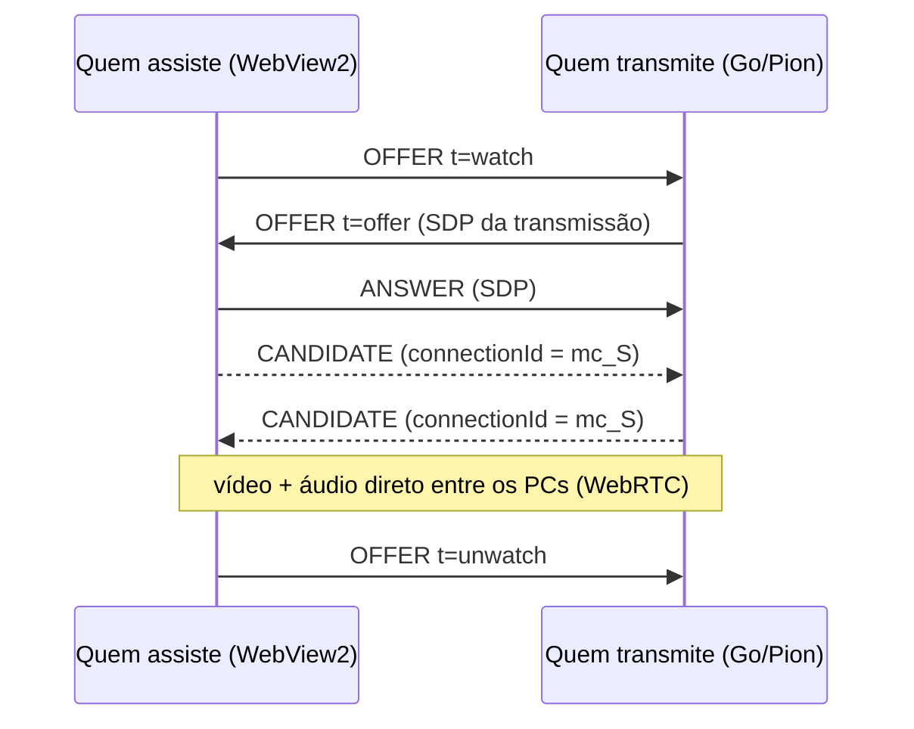

# Protocolo entre apps

Os apps não têm servidor próprio. Para se encontrar e combinar as conexões eles usam o
servidor público de sinalização do [PeerJS](https://peerjs.com) (`wss://0.peerjs.com/peerjs`),
que só repassa mensagens pequenas entre quem está conectado. O vídeo e o áudio vão
direto entre os PCs, por WebRTC.

Código: [`internal/signaling`](../internal/signaling/signaling.go) (envelope e conexão) e
[`internal/social`](../internal/social/social.go) (o que cada mensagem significa).

> **Compatibilidade:** nem todo mundo atualiza ao mesmo tempo. Qualquer mudança aqui
> precisa continuar funcionando com a versão anterior — campos novos são opcionais e tipos
> desconhecidos são ignorados.

## Identidade

Cada instalação tem um **código de amigo** de 8 caracteres (alfabeto sem letras/números
ambíguos: `abcdefghjkmnpqrstuvwxyz23456789`), gerado na primeira execução e salvo no
`config.json`. No servidor PeerJS o id é `telau-<código>` — o prefixo vem do nome antigo
do projeto e **não pode mudar** sem quebrar a comunicação com versões anteriores.

Se o servidor responder `ID-TAKEN` (o mesmo código já está conectado, ex.: o app aberto
duas vezes), o app avisa e tenta de novo.

## Envelope

O servidor público **derruba a conexão** de quem envia algo diferente do que o cliente
PeerJS oficial enviaria. Por isso toda mensagem imita uma "media connection" do PeerJS:

```json
{
  "type": "OFFER",
  "dst": "telau-abcd2345",
  "payload": {
    "type": "media",
    "connectionId": "mc_<código de quem transmite>",
    "sdp": { "type": "offer", "sdp": "v=0..." },
    "t": "ping",
    "d": { "name": "Ana" }
  }
}
```

| Campo | Significado |
|---|---|
| `type` | `OFFER`, `ANSWER` ou `CANDIDATE` (os únicos que o servidor repassa). Mensagens de controle vão como `OFFER`. |
| `payload.type` | sempre `"media"` (exigido pelo servidor). |
| `payload.connectionId` | identifica **a transmissão de quem** a mensagem trata: `mc_<código do dono da transmissão>`. Necessário porque duas pessoas podem assistir uma à outra ao mesmo tempo. |
| `payload.sdp` | obrigatório em `OFFER`/`ANSWER`. Mensagens de controle levam um SDP vazio de enfeite. |
| `payload.t` | tipo da mensagem de controle (tabela abaixo). Ausente em `ANSWER`/`CANDIDATE`. |
| `payload.d` | dados da mensagem de controle (JSON, opcional). |

Outras regras do servidor:

- O cliente manda `HEARTBEAT` a cada poucos segundos, senão a conexão cai.
- `LEAVE` sem payload derruba a conexão — não use.
- Quando o destino não está conectado, o servidor responde **`EXPIRE`** com `src` = o
  destino. O app trata isso como "essa pessoa está offline".

## Mensagens de controle (`payload.t`)

`hello` = `{ "name": string, "room"?: RoomInfo }`.

### Amizade e presença

| `t` | `d` | Quando |
|---|---|---|
| `fr-req` | hello | Pedido de amizade. Reenviado a cada ciclo de presença enquanto não for aceito (a pessoa pode estar offline). Se os dois se adicionaram, vira amizade direto. |
| `fr-acc` | hello | Pedido aceito. |
| `fr-del` | — | Desfez a amizade. |
| `ping` / `pong` | hello | Presença: a cada **15 s** cada app manda `ping` aos amigos, que respondem `pong`. Um amigo sem notícias há **40 s** é mostrado como offline. O `room` informa a sala aberta (para aparecer "Entrar"). |

Mensagens de quem não é amigo são ignoradas (exceto `fr-req`).

### Salas

A sala é coordenada pelo **dono**: ele mantém a lista de membros e a envia a todos.

| `t` | `d` | De → para | Significado |
|---|---|---|---|
| `invite` / `uninvite` | hello | dono → amigo | Convite para a sala (ou cancelamento). |
| `join` | hello | membro → dono | Pedido para entrar. Aceito se convidado, ou se a sala é pública e quem pede é amigo do dono. |
| `join-no` | `{ "reason": string }` | dono → membro | Pedido recusado. Sem resposta em **12 s**, o app desiste. |
| `room` | Room | dono → membros | Estado completo da sala. Enviado a cada mudança e a cada **10 s**; um membro que fica **35 s** sem receber considera a sala encerrada. Se o membro não está na lista, saiu/foi removido. |
| `leave` | — | membro → dono | Saiu da sala. |
| `closed` | — | dono → membros | O dono fechou a sala (ou saiu dela). |
| `share` | `{ "on": bool }` | membro → dono | Começou/parou de transmitir. |

`Room` = `{ "owner", "ownerName", "public", "members": [{ "code", "name", "streaming" }] }`.

### Transmissão

Só membros da mesma sala podem assistir uns aos outros.



| `t` | De → para | Significado |
|---|---|---|
| `watch` | espectador → transmissor | Quero assistir. Quem transmite cria uma conexão WebRTC e manda a oferta. Se quem pede não está na sala, responde `bye`. |
| `offer` | transmissor → espectador | Oferta WebRTC (no `payload.sdp`). |
| `unwatch` | espectador → transmissor | Parei de assistir. |
| `bye` | transmissor → espectador | A transmissão acabou (ou o pedido foi recusado). |

A resposta (`ANSWER`) e os candidatos ICE (`CANDIDATE`) usam os tipos próprios do PeerJS.
Quem transmite **oferece** (é ele quem define codecs e bitrate); quem assiste responde
pelo WebRTC do próprio WebView2.
